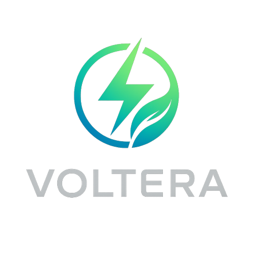
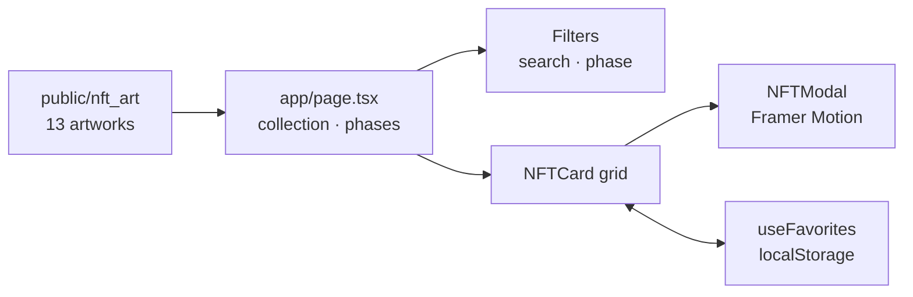

<div align="center">



# VoltEra Nexus

### The Energy Consciousness Protocol

An interactive digital-art gallery about clean energy, networks and digital sovereignty:
13 original artworks told in three phases — Light, Network and Subnet.

[](https://n3xus.dev)
[](docs/WHITEPAPER.md)
[](LICENSE)

[](package.json)
[](package.json)
[](tsconfig.json)
[](tailwind.config.js)
[](package.json)
[](SECURITY.md)

</div>

---

## Table of Contents

- [Overview](#overview)
- [Experience](#experience)
- [Architecture](#architecture)
- [Quickstart](#quickstart)
- [Repository structure](#repository-structure)
- [Scope](#scope)
- [Current status](#current-status)

---

## Overview

**VoltEra Nexus** is a creative-technology experiment: a responsive gallery and storytelling site built around
13 energy-themed artworks. The narrative moves from generation (*Light*) to distribution (*Network*) to
autonomous edge nodes (*Subnet*), the same arc as the [VoltEra](https://github.com/Samurai33/voltera) product
concept.

It is built for:

- showing a product narrative through art instead of slides;
- experimenting with motion, filtering and favorites in a small Next.js codebase;
- anyone curious about where energy, networks and digital art meet.

---

## Experience

| Feature | Details |
|---|---|
| **Gallery** | 13 original artworks in [`public/nft_art`](public/nft_art) |
| **Three phases** | Light, Network and Subnet, each with its own story |
| **Search & filters** | Find by name or filter by phase |
| **Favorites** | Saved in the browser (`localStorage`), no account needed |
| **Artwork modal** | Animated detail view with external marketplace links |
| **Responsive dark UI** | Built for phone and desktop |

---

## Architecture



---

## Quickstart

```bash
git clone https://github.com/Samurai33/VoltEra-Nexus-The-Energy-Consciousness-Protocol.git
cd VoltEra-Nexus-The-Energy-Consciousness-Protocol
npm install
npm run dev
```

Checks:

```bash
npm run type-check
npm run build
```

---

## Repository structure

| Path | What it is |
|---|---|
| `src/app/` | Next.js App Router layout, page and global styles |
| `src/components/` | Header, Filters, NFTCard, NFTModal |
| `src/hooks/useFavorites.ts` | Favorites persisted in the browser |
| `public/nft_art/` | The 13 artworks |
| `docs/WHITEPAPER.md` | The original narrative whitepaper (Portuguese) |

---

## Scope

This is an art and interface project. Mentions of decentralized energy, Web3 or environmental impact are part
of the story. They are not deployed infrastructure, investment products or verified environmental outcomes.

Related work: [VoltEra](https://github.com/Samurai33/voltera) (product dossier) ·
[GreenPulse](https://github.com/Samurai33/GreenPulse) (operational dashboard).

---

## Current status

| | |
|---|---|
| **Stage** | Complete gallery, runs locally |
| **Data** | Static collection, no backend |
| **Not included** | Wallet connection, minting, analytics |

---

<div align="center">

**Need something built, secured or kept online?** → [contato@n3xus.dev](mailto:contato@n3xus.dev) · [n3xus.dev](https://n3xus.dev)

MIT © Thiago "Samurai" Rangel · [N3XUS](https://n3xus.dev)

</div>
